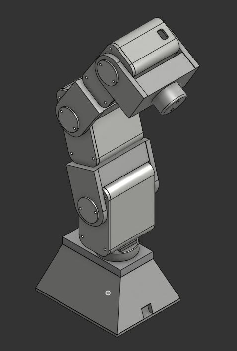
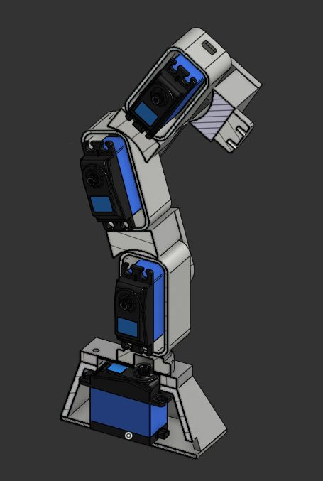

# Cyberarm

I'm building a small robot arm with four standard-size servos. I wanted to see how compact I could make it while keeping the motors tucked inside.

## What I built

I built it in Onshape, starting with the base and working my way up. The base turns, and the shoulder, elbow, and wrist bend. The hardest part was getting the covers to sit close together while leaving room for the joints to turn.

Here's a look inside. The four blue servos sit in the base, shoulder, elbow, and wrist.

## Try the CAD

Open the [Onshape assembly](https://cad.onshape.com/documents/ad097671b3f20c84e2682bd8/w/9a3fe940931d480ebae8f6bb/e/0d2558ab2371cadab29e2141). In **Named positions**, try **Folded upright** or **Forward reach**.

## Keyboard controls

On a Raspberry Pi 4B with a 16-channel PCA9685 Servo HAT, use channels 0–3 for the base through wrist. Follow the [Servo HAT setup guide](https://learn.adafruit.com/adafruit-16-channel-pwm-servo-hat-for-raspberry-pi/using-the-python-library) to enable I²C and install ServoKit.

Run `python3 arm_keys.py`. Type **A/D** for the base, **W/S** for the shoulder, **J/L** for the elbow, or **I/K** for the wrist, then press Enter. Each step is 5°. **Q** quits.
